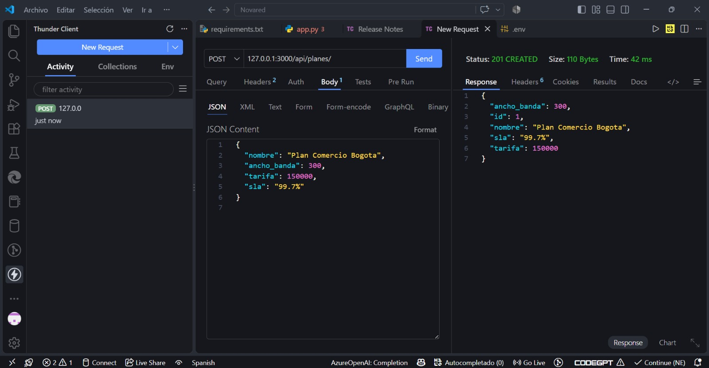
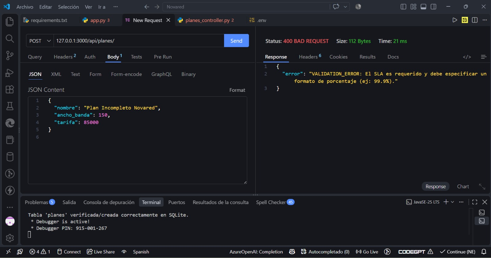
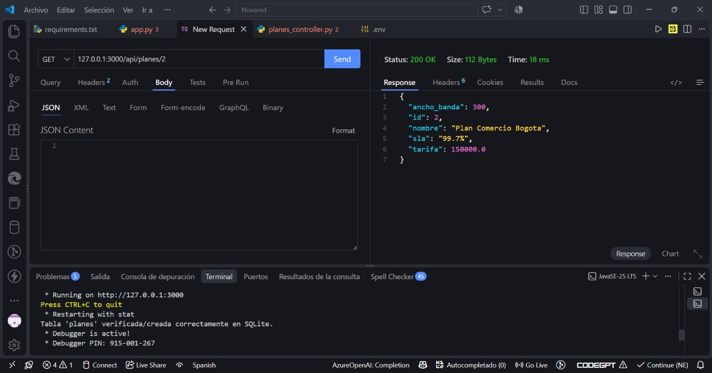

# NOVARED - Núcleo del Servidor (Backend v1.0.0)
**Asignatura:** Ingeniería de Software III  
**Período Académico:** 4 Cuatrimestre - Universidad INCCA  
**Año de Desarrollo:** 2026  

### Integrantes / Alumnos del Proyecto:
* **Mercedes Del Pilar Mosquera Martínez**
* **Luz Amparo Sánchez Archila**
* **Yeisten Osvaldo Murcia Vásquez**
* **Alvaro Gerardo Rondón Carvajal**

---

## 1. Descripción del Proyecto y Entidad Elegida

### Contexto del Sistema (Proyecto de Aula)
**NOVARED** es una solución tecnológica diseñada para centralizar, administrar y asegurar la información operativa de conectividad orientada a empresas PYME del sector comercial en la ciudad de Bogotá. La problemática central que resuelve este sistema es la ineficiencia administrativa, la pérdida de datos de clientes, errores de facturación y las dificultades para controlar de manera estricta los Acuerdos de Nivel de Servicio (**SLA**) y anchos de banda contratados.

### Entidad Elegida para el Avance: `Planes`
Para este hito de revisión, se seleccionó el módulo de **Planes** como el núcleo estructural del negocio. Esta entidad define el catálogo de servicios de telecomunicaciones que la microempresa comercializa. Controlar esta entidad mediante una API robusta permite:
* Automatizar y estandarizar las tarifas vigentes del mercado de telecomunicaciones colombiano.
* Validar técnicamente las capacidades de conectividad (Mbps) y cumplimiento de SLAs antes de su asignación contractual.
* Evitar pérdidas económicas garantizando que ningún servicio se comercialice por debajo de los costos mínimos operativos establecidos para el sector comercial PYME de Bogotá (\$50,000 COP).

## Estructura de Directorios para NOVARED

```text
Novared/
├── data/
│   └── app.db                    # Base de datos SQLite
├── evidencias/                   # Capturas de las pruebas de la API
├── src/
│   ├── app.py                    # Punto de entrada e inicio del servidor Flask
│   ├── db/
│   │   └── database.py           # Conexión e inicialización de tablas
│   ├── routes/
│   │   └── planes_routes.py      # Endpoints (Blueprints)
│   ├── controllers/
│   │   └── planes_controller.py # Orquestación HTTP (Request/Response)
│   ├── services/
│   │   └── planes_service.py     # Lógica y validaciones de negocio
│   └── repositories/
│       └── planes_repository.py  # Consultas SQL parametrizadas
├── .env                          # Variables de entorno locales
├── requirements.txt              # Dependencias del proyecto
└── README.md
```

---

## 2. Instrucciones de Configuración y Execution Local

Este proyecto ha sido desarrollado bajo una arquitectura limpia de capas separadas (Rutas ➔ Controladores ➔ Servicios ➔ Repositorios) garantizando el principio de separación de responsabilidades. El núcleo del servidor está implementado de forma eficiente en **Python 3** y **Flask**, utilizando **SQLite** como motor de persistencia relacional local automatizado.

Siga estos pasos secuenciales en la consola de comandos de Windows (CMD) desde la raíz del proyecto (`/Novared`) para desplegar el servidor:

### Paso 1: Instalación de Dependencias
Instale los módulos necesarios especificados en el manifiesto de requerimientos del sistema:
```bash
pip install -r requirements.txt
```

### Paso 2: Configuración del Entorno de Variables
Asegúrese de contar con el archivo de configuración `.env` en la raíz del proyecto con las siguientes variables declaradas:
```env
PORT=3000
DB_FILE=./data/app.db
FLASK_ENV=development
```

### Paso 3: Inicialización y Ejecución del Servidor
Ejecute el punto de entrada de la aplicación utilizando el intérprete de Python en modo módulo. El sistema detectará automáticamente la base de datos local e inicializará de manera transparente la estructura de tablas requerida en SQLite si no existe:
```bash
python -m src.app
```

Una vez ejecutado, el backend quedará listo para escuchar peticiones en: `http://127.0.0`

---

## 3. Matriz de Validación de Endpoints (API REST)

El backend responde estrictamente a los siguientes códigos de estado e interacciones verificadas de forma la tabla de requisitos obligatorios:

* **Operación: Listar Todos (GET /api/planes/):** Retorna un arreglo JSON con el catálogo completo y código **200 OK**.
* **Operación: Consultar por ID (GET /api/planes/\<id\>):** Busca un registro único. Retorna el JSON con código **200 OK** si existe, o código **404 Not Found** si es inexistente.
* **Operación: Crear Registro (POST /api/planes/):** Procesa datos de tarifas y SLAs. Si son correctos, retorna un código **201 Created**. Si infringe reglas de validación, responde con un código **400 Bad Request**.
* **Operación: Actualizar (PUT /api/planes/\<id\>):** Modifica los atributos de un plan existente tras validar su presencia en la base de datos, retornando un código **200 OK**.
* **Operación: Eliminar (DELETE /api/planes/\<id\>):** Remueve permanentemente el registro de SQLite y retorna un cuerpo vacío de 0 Bytes junto al estado obligatorio **204 No Content**.

---

## 4. Evidencias Visuales de Pruebas Locales (Thunder Client)

A continuación, se detallan los comandos de consola y las rutas de las capturas de pantalla que validan el comportamiento del núcleo del servidor ante los tres escenarios clave requeridos por la rúbrica:

### A. Camino Feliz (Creación exitosa con estado 201 Created)
* **Comando de prueba (cURL):**
  ```bash
  curl -X POST http://127.0.0 -H "Content-Type: application/json" -d "{\"nombre\": \"Plan Comercio Bogota\", \"ancho_banda\": 300, \"tarifa\": 150000, \"sla\": \"99.7%\"}"
  ```
* **Evidencia Visual:**
  

---

### B. Manejo de Errores de Validación (Datos Inválidos/Incompletos con estado 400 Bad Request)
* **Comando de prueba (cURL):**
  ```bash
  curl -X POST http://127.0.0 -H "Content-Type: application/json" -d "{\"nombre\": \"Plan Comercio Bogota\", \"ancho_banda\": 300, \"tarifa\": 30000, \"sla\": \"99.7%\"}"
  ```
* **Evidencia Visual:**
  

---

### C. Consulta de un Plan (Consulta de ID Existente con estado 200 OK)
* **Comando de prueba (cURL):**
  ```bash
  curl -X GET http://127.0.0.1:3000/api/planes/2
  ```
* **Evidencia Visual:**
  
